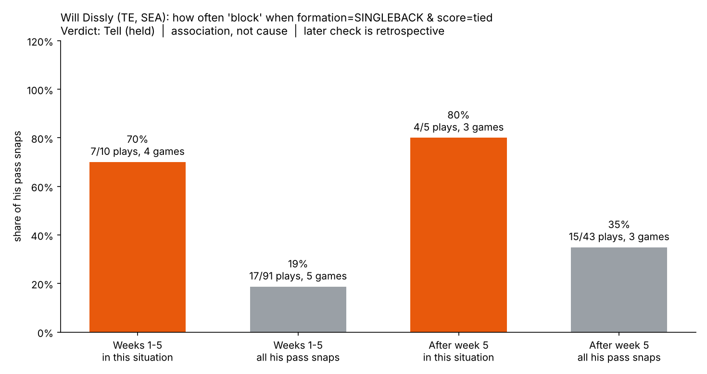
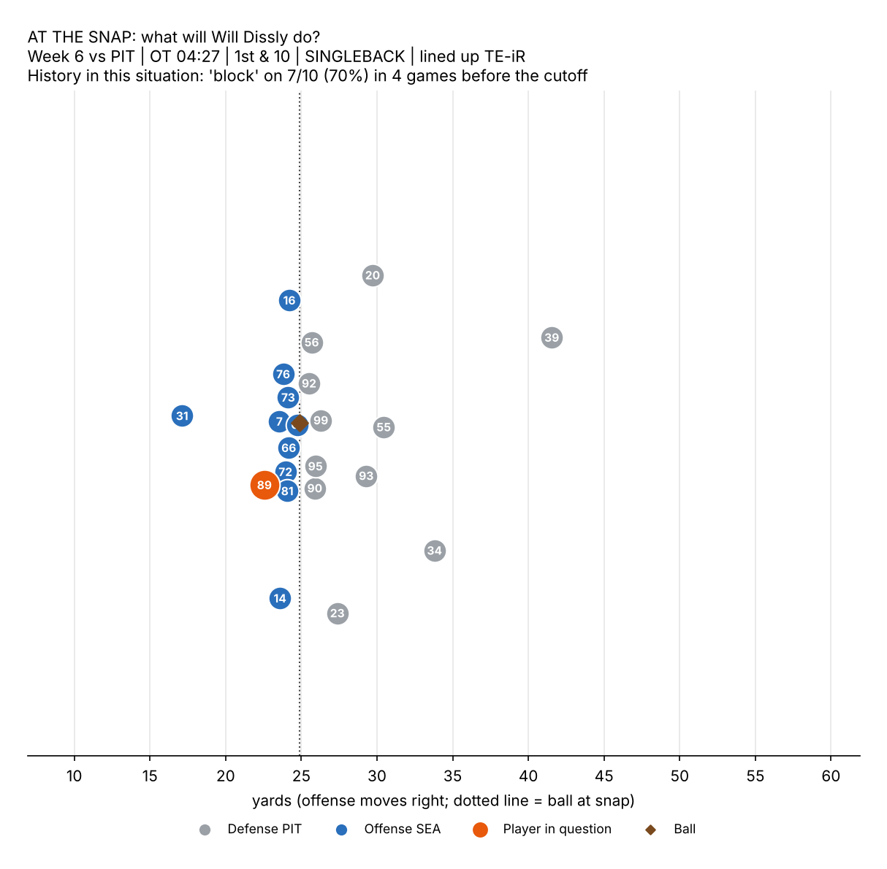
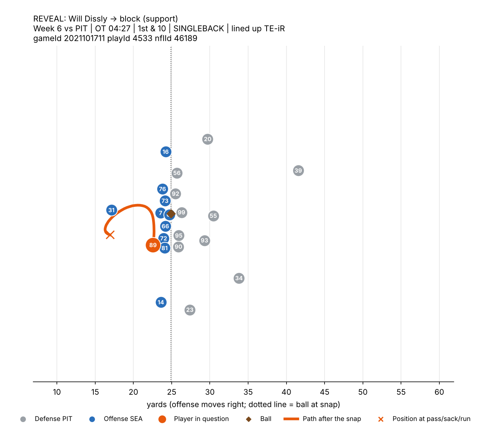
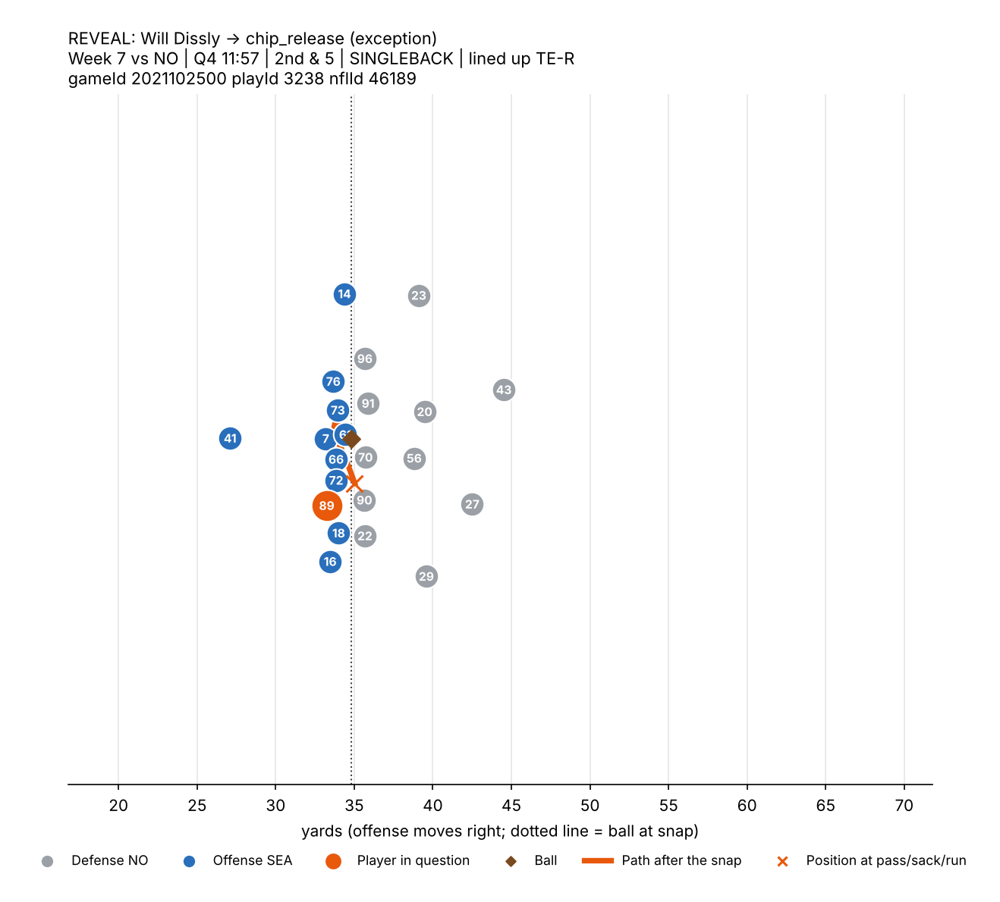

# Tell or Trap

**What it is.** Tell or Trap is a scouting notebook (`tell_or_trap.ipynb`, pandas + numpy + Plotly) for a coach studying an opponent or self-scouting: pick a team (or one player) and a cutoff week, and it finds snap-time situations in which a running back or tight end blocks or chip-releases far more often than he usually does on pass plays, then checks each tendency in the games after the cutoff. **Insight.** With the default settings (Seattle, cutoff week 5), TE Will Dissly stayed in to block on 7 of 10 dropbacks (70%, 4 games) from singleback formations with the score tied, against 17 of 91 (19%, 5 games) on all his pass snaps; in Weeks 6-8 the same situation gave 4 of 5 (80%, 3 games) against 15 of 43 (35%) overall, and the notebook freezes one of those later plays at the snap, shows the evidence, reveals his path, and also shows the one exception. **Methods.** Outcomes come from PFF post-snap charting (`pff_role`, `pff_blockType`), with unclear labels kept as an explicit "ambiguous" class; predictor inputs are limited to what is known by the snap (down, distance, field position, score, clock, formation, personnel, box count, alignment), the split is chronological, and every rate is reported with its play count and number of games, keyed by `gameId`, `playId` and `nflId`. **Limitations.** League-wide, of the 198 top-ranked tendencies that had at least 5 later plays, 83 (42%) held and 115 did not, and 122 more had too few later plays to judge, so a discovered tendency is a lead to check on film, not a guarantee, and not every team yields one. The data covers dropbacks only (no run/pass tell), results are associations rather than causes, samples are small, tracking starts about half a second before the snap so pre-snap motion is not used, and because we had already looked at some Weeks 6-8 results the later-game check is retrospective, not an untouched test.

## Demo (default settings)

Static previews of the notebook's interactive Plotly figures.



**Freeze a later play at the snap...**



**...then reveal what he did.**



**An exception: same situation, different assignment.**



## Run it

```
pip install -r requirements.txt
jupyter notebook tell_or_trap.ipynb   # Kernel > Restart & Run All
```

- Data is read from `data/` (the event dataset: https://github.com/ThompsonJamesBliss/nfl-big-data-bowl-regional-event-data). A missing file is downloaded once and cached there.
- Tracking is loaded only for the games of the plays shown in the demo.
- All choices (team, player, cutoff week, thresholds, features) are in the single `CONFIG` cell.

## Outputs (written to `outputs/` on each run)

- `tendency.html` - situation rate vs usual rate, before and after the cutoff
- `later_play_freeze.html`, `later_play_reveal.html` - a later play frozen at the snap, then the reveal
- `exception_freeze.html`, `exception_reveal.html` - a later play where the tendency did not hold
- `league_scoreboard.html`, `league_tendencies.csv` - Tell / Trap / too-few-plays counts for every team
- `later_plays_demo_rule.csv` - every later play in the demo situation
- `preview_*.png` - static previews of the demo figures for this README (drawn from the same notebook functions and data)
